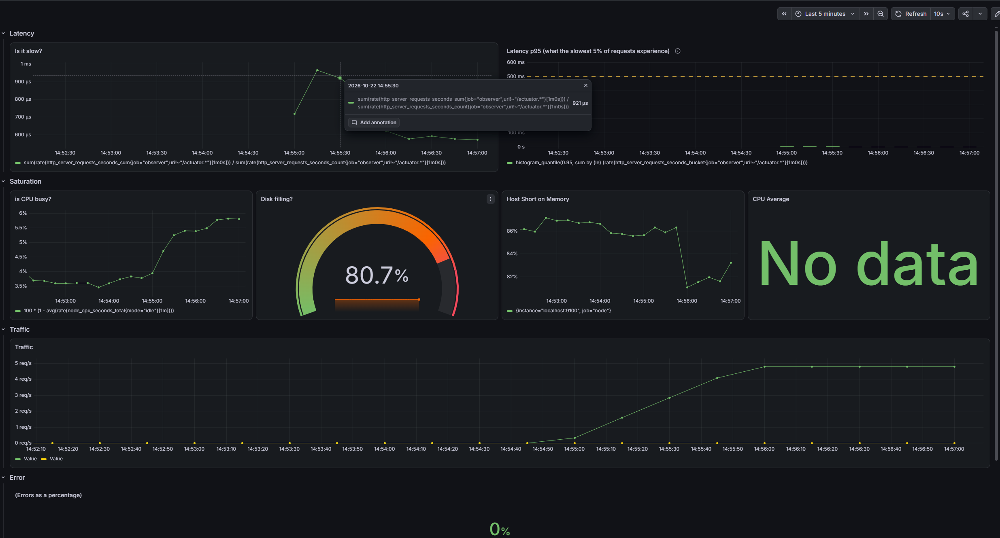
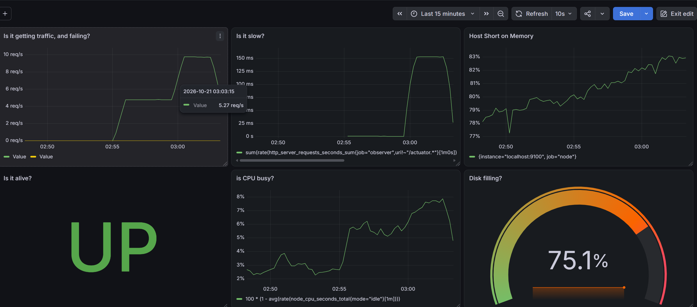

# 01 – Latency vs Process Health

Test that elevated request latency is invisible to the Actuator health endpoint while still visible in Grafana and Prometheus.

## Baseline
Normal traffic, healthy application.  
Command: `make chaos-baseline DURATION=90`
  


## Chaos Stimulation
Inject 300 ms artificial latency for 30s or 90 for better observation.  

```bash
# Run on terminal
make chaos-latency MS=300 DURATION=30
```

## Observing Latency

Health endpoint still returns UP & Grafana latency panel rises during the same window.



## Alert
Prometheus alert fires on the latency threshold


## Post Expirement

Latency returns to normal after the 30 s window.


### Summary

- The chaos-latency target generates application-induced latency.
- The MS=300 argument configures a 300 millisecond delay for this run.
- The DURATION=30 argument keeps the experiment active for 30 seconds.
