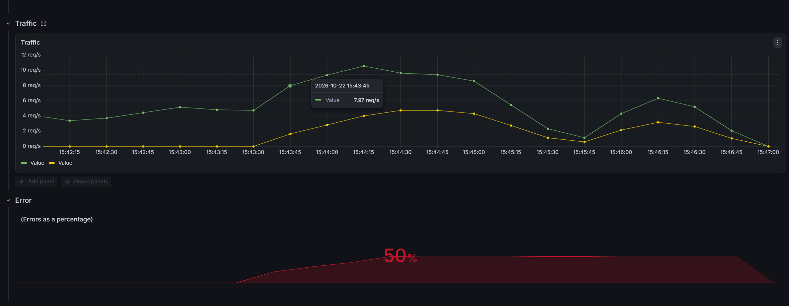
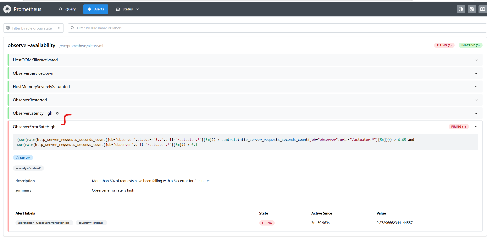
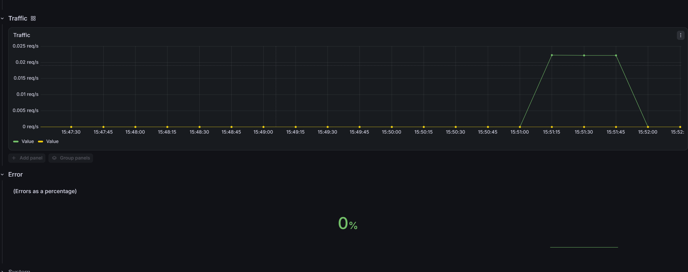

# 02 – Errors vs Process Health

Test that deterministic HTTP 500 responses stay invisible to the Actuator health endpoint while clearly visible in Grafana and Prometheus.

## Baseline
Normal traffic, healthy application.  


## Chaos Stimulation
Inject deterministic server errors for 30 s.  
```bash
make chaos-errors DURATION=30
```

## Observing Errors
Observing ErrorsHealth endpoint still returns UP. Grafana server-error panel rises during the same window.


## Alert
AlertPrometheus fires ObserverErrorRateHigh `(5xx rate > 5 % for 2 m)`.



## Post-Experiment
Post-experimentError rate returns to normal after the window.

