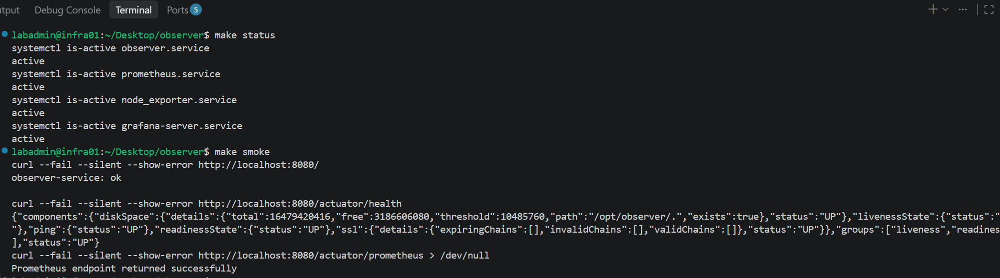
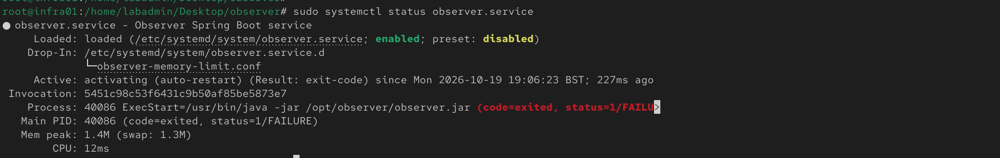
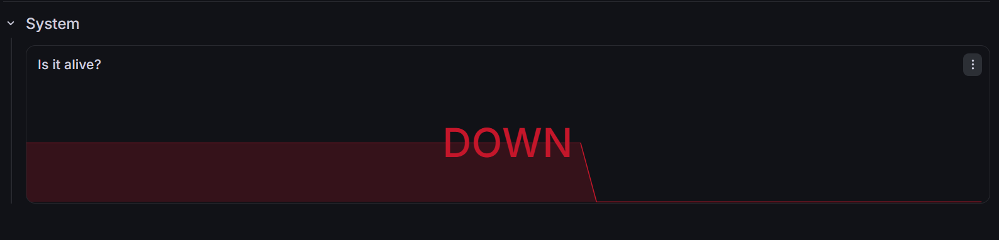
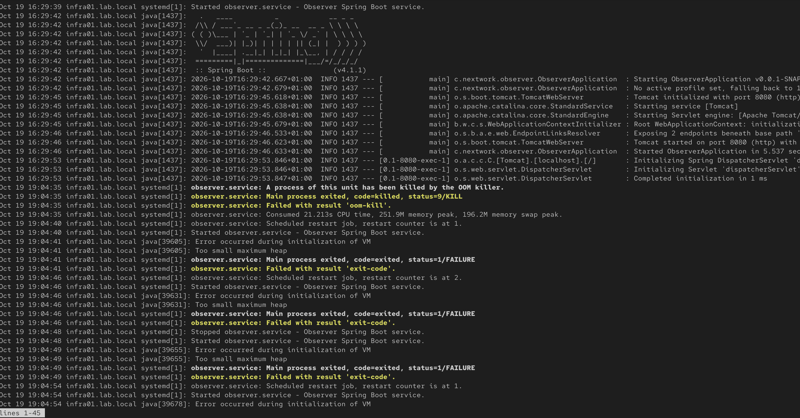
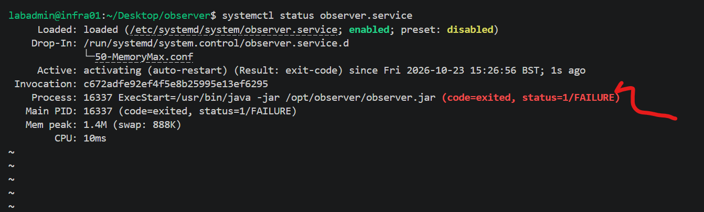
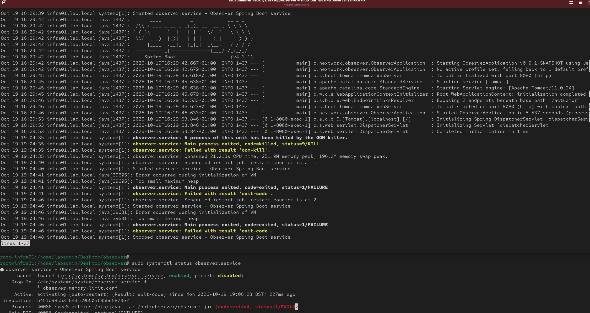
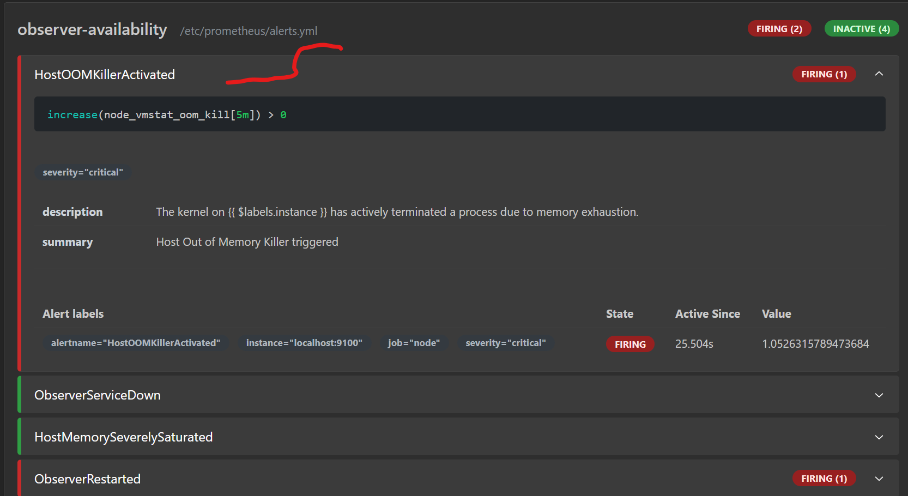
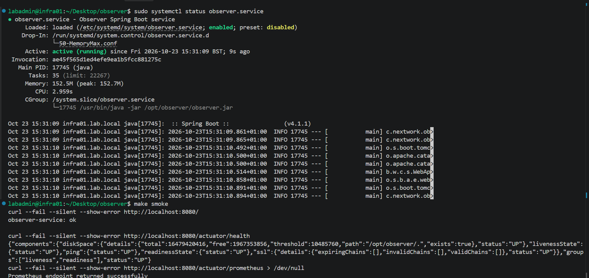
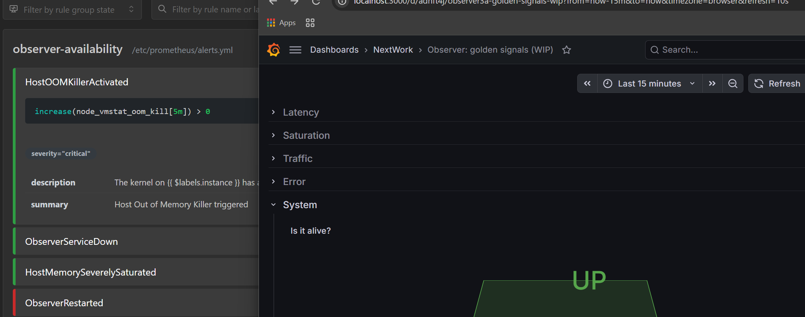

# 03 – Memory Limit & OOM

A 1500K MemoryMax ceiling forces the JVM to exceed its cgroup limit. The Linux OOM killer terminates the process; systemd records the repeated start failures. This is pure resource-control evidence — the application never even reaches a healthy state.

#### Why Cgroup Evidence Matters

The memory.max value is the cgroup v2 memory hard limit. If memory usage reaches that limit and cannot be reduced, the OOM killer acts inside the cgroup.

#### Prove a cgroups v2 Memory Guardrail
That evidence identifies the failure domain more precisely than a missing application response alone. This stimulation applies a deliberately tight memory ceiling through systemd. You will use cgroups v2 evidence to distinguish a resource-control incident from an ordinary stopped service.

 Create the memory guardrail
The MemoryMax directive defines a hard memory ceiling for every process in the service's control group. Keeping this setting in the repository makes the experiment reproducible.

### Apply the limit
```bash
# Make sure the service is running
sudo systemctl daemon-reload
sudo systemctl restart observer.service
#0r use the make smoke command to check service is running and healthy
make smoke
```


**Checking the observer.service MemoryMax before applying limit**
```bash
$ systemctl show show observer.service -p MemoryMax
MemoryMax=infinity
MemoryMax=infinity
```
**Run the following command to apply the memory limit only for the current boot:**
```bash
sudo systemctl set-property --runtime observer.service MemoryMax=1500K

# Verify change 
 systemctl show --runtime observer.service -p MemoryMax
MemoryMax=1536000

# Restart the service 
sudo systemctl restart observer.service 
```
*Note the max limit  modification wont persist after boot*

## Confirm the failure


##### Captured "Service is downn" - Grafana


#### Investigating Clues & Logs





### Prometheus OOMKiller Alert Fired


## Remove the limit & recover
Reboot the system to revert changed or simply run: 
```bash
sudo systemctl set-property --runtime observer.service MemoryMax=infinity
# restart the service
sudo systemctl restart observer.service
```





# Takeaway

Cgroup limits (MemoryMax, CPUQuota, etc.) are enforced by the kernel, not the application. A tight MemoryMax forces an OOM kill; a tight CPUQuota produces throttling and latency. These failures often never appear as clean HTTP 5xx or Grafana spikes the process simply never stays alive.

Dashboards are useful once the service is running. When it is not, the real evidence lives in:
- `systemctl status` (lifecycle & restart loops)
- `journalctl -u <service> -b` (OOM killer messages, exit codes)
- cgroup files under `/sys/fs/cgroup/...` (the actual enforced limits)

Resource Control incidents are diagnosed at the OS boundary, not only on the application dashboard.