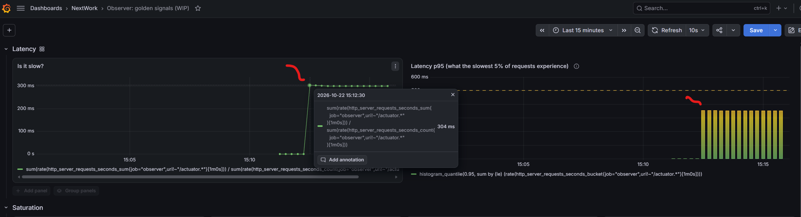

# Health Check Blind Spot

**Question:** Can `/actuator/health` say `UP` while users are having a bad time?

This page records the healthy starting point. Later results are compared against it.

## Service Check

Run from the repository root:

```bash
make smoke
make chaos-check
```

Expected:

- `make smoke` prints `observer-service: ok`, a health response with `"status":"UP"`, and `Prometheus endpoint returned successfully`.
- `make chaos-check` prints `observer is healthy`.

All three endpoints respond, so the service is ready for a test.


## Healthy Traffic Baseline

Traffic: normal requests to `/` only (`make chaos-baseline`), measured after the app has been running for a few minutes.

| Signal | Healthy value |
| --- | --- |
| Traffic | 4.76 req/s |
| Latency (average) | about 0.3 to 1 ms |
| Latency (p95) | about 1 to 3 ms |
| Errors | 0% |
| CPU | 5.70% |
| Memory | 71% used |
| Disk | 19% free (3.2 GB of 16.4 GB) |


##### Screenshots 



*Latency panel at baseline: both lines sit near zero, so any later rise is a real change.*

#### What This Is For

If a fault later raises latency or errors while `make smoke` still passes, the health check was blind to it. This baseline is what the fault results are compared against.
